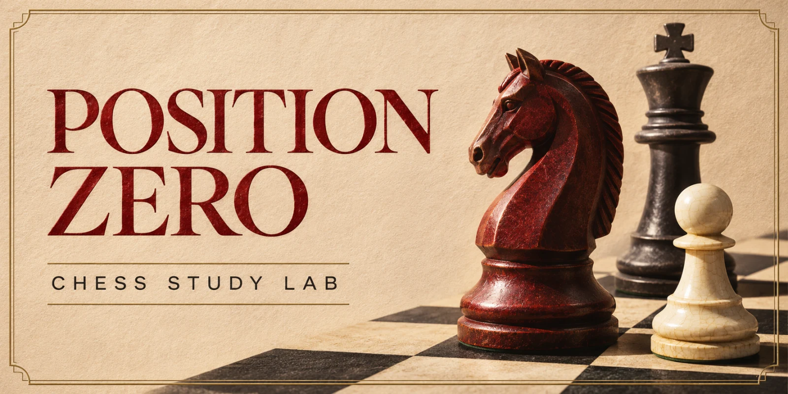

# POSITION ZERO

[English](README.md) | [简体中文](README.zh-CN.md)



POSITION ZERO is a local-first chess study app for Apple Silicon Macs. It turns
games and screenshots into numbered studies with Stockfish analysis, verifiable
coaching notes, and active-recall cards.

## Launch the built app

After [building the app](#development), open it from the repository root:

```sh
open "src-tauri/target/release/bundle/macos/POSITION ZERO.app"
```

You can also open the same path in Finder and double-click `POSITION ZERO.app`.
Because this personal build is unsigned and unnotarized, macOS may block its
first launch. If that happens, Control-click the app, choose **Open**, then
confirm **Open** once more. Do not move the app out of its bundle directory
without rebuilding it.

## What works

- PGN file, drag/drop, and clipboard import, including multi-game selection,
  comments, NAGs, and variations.
- Full-FEN import and local screenshot-to-FEN recognition with an explicit
  board correction and metadata confirmation step.
- Bundled Stockfish 18 UCI sidecar with Quick, Scan, and Deep profiles,
  MultiPV streaming, cancellation, WDL grading, and SQLite analysis caching.
- A collapsible `ENGINE SETTINGS` panel exposes Threads, Hash (MiB), MultiPV,
  and fixed search depth; depth 0 uses the selected time limit.
- Offline ECO/opening names compiled from the Lichess CC0 opening dataset;
  game scans begin at the first departure from known theory.
- Numbered studies, notes, player alias recognition, PGN export, suggested
  training-card positions, and Again/Hard/Good review scheduling.
- Swappable board skins: `mono` hatch, `auction` parchment/oxblood/brass,
  `court` porcelain/celadon, and `noir` charcoal/bone/brass, each with a day and
  a night palette that is remembered between launches. See `design/board-skins.md`.

The app makes no network requests at runtime. Network access is only needed
while installing dependencies and downloading the verified Stockfish binary.

After launch, the `LOCAL ENGINE` panel should show `READY` within a few
seconds. If it shows `STARTING`, wait for the UCI handshake. If it shows
`ERROR` or `STOPPED`, use `RESTART ENGINE`; the app also polls the engine every
three seconds and retries after an unexpected exit.

## Development

Requirements: macOS on Apple Silicon, Xcode command-line tools, Rust, and a
current Node.js runtime.

```sh
npm install
npm run setup:stockfish
npm test
cargo test --manifest-path src-tauri/Cargo.toml
npm run tauri dev
```

Create the local `.app` bundle with:

```sh
npm run tauri build
```

The build is intentionally unsigned and unnotarized. App data is stored in the
Tauri application data directory as `position-zero.db`. Engine cache entries
have a 256 MiB soft limit and can be cleared from the position index.

## Runtime resources

- `public/models/chess-tiles-v2.onnx` and `public/ort/*.wasm` are generated by
  `npm install` from the installed fenshot and onnxruntime packages.
- `public/data/openings.json` is generated from the vendored CC0 TSV sources.
- `src-tauri/binaries/stockfish-aarch64-apple-darwin` is installed by the
  checksum-verifying setup script and is intentionally ignored by Git.
- Background music is optional. To enable it in a local build, supply your own
  MP3 files as `public/audio/bach-cello-suite-no-1-prelude-dark.mp3` and
  `public/audio/focus-40hz.mp3`.

See [THIRD_PARTY_NOTICES.md](THIRD_PARTY_NOTICES.md) before distributing a
build outside your own machine.
