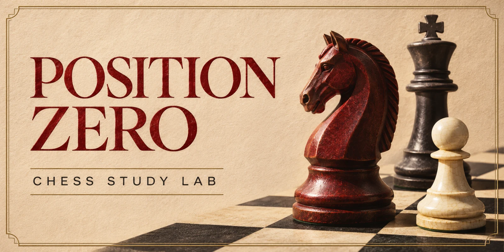

# POSITION ZERO

[English](README.md) | [简体中文](README.zh-CN.md)



POSITION ZERO 是一款面向 Apple Silicon Mac 的本地优先国际象棋局面训练工具。它可以把棋谱、FEN 和棋盘截图整理为编号研究局面，并提供 Stockfish 分析、可验证的规则化讲解和主动回忆训练卡。

## 启动现有 App

构建 App 后，在项目根目录运行：

```sh
open "src-tauri/target/release/bundle/macos/POSITION ZERO.app"
```

也可以在 Finder 中前往下面的目录，然后双击 `POSITION ZERO.app`：

```text
src-tauri/target/release/bundle/macos/
```

这是个人本地构建，没有签名和公证。macOS 第一次启动时如果阻止打开：

1. 按住 Control 点击 `POSITION ZERO.app`。
2. 在菜单中选择“打开”。
3. 在确认窗口中再次选择“打开”。

应用运行后不需要网络。棋谱、截图、研究条目和分析结果均保存在本机。

启动后右侧 `LOCAL ENGINE` 应在几秒内显示 `READY`。如果显示 `STARTING`，请等待握手完成；如果显示 `ERROR` 或 `STOPPED`，点击提示中的 `RESTART ENGINE`。应用会每 3 秒检查一次引擎状态，并在意外退出后自动尝试重启。

## 当前功能

- 通过文件、拖放、剪贴板导入 PGN，支持多局棋谱选择、注释、NAG 和变化分支。
- 导入完整 FEN，并进行局面合法性检查。
- 使用本地 fenshot ONNX/WASM 模型识别数字截图和印刷棋盘图；提交前可以逐格修正棋子，并补全行棋方、王车易位权、吃过路兵和回合信息。
- 捆绑 Stockfish 18 ARM64 引擎，提供快速分析、整局浅扫和 5/15/60 秒深析。
- 流式显示 MultiPV 候选变化；切换局面或分析档位时取消并替换旧任务。
- 右侧 `ENGINE SETTINGS` 可折叠调整 Threads、Hash（MiB）、MultiPV 和固定 Depth；Depth 为 0 时按 Quick/5s/15s/60s 的时间限制搜索。
- 使用 SQLite 保存研究库、玩家别名、训练卡、复习记录和分析缓存。
- 使用本地 Lichess CC0 开局数据标注 ECO 和开局名称，并从首次偏离理论的位置开始浅扫。
- 生成 `PZ—####` 编号研究卡，保存个人笔记、导出 PGN，并按 Again、Hard、Good 进行间隔复习。
- 棋盘皮肤可换装：`mono` 黑白斜线、`auction` 羊皮纸/牛血红/黄铜、`court` 瓷白/青瓷、`noir` 炭灰/骨白/黄铜；每套都有白天与夜间配色，选择会保留。设计说明见 `design/board-skins.md`。
- `Auction oxblood`（猩红）搭配新版红黑艺术棋子：持剑死神黑王、丰饶角黑后、舟形车、麦穗与锁链兵。12 枚透明 PNG 随应用本地打包，不联网加载；其他主题保留原标准棋子。
- 棋盘上方可切换 `2D 棋盘` / `3D 黑白`：经典 CC0 六种模型、黑白材质与阴影、本地 GLB 加载；点击走子、拖动旋转、滚轮缩放、重置视角。与当前 FEN、分析轨道、翻转和引擎标记共用状态。3D 暂不换红黑艺术套装，WebGL 不可用时可返回 2D。
- 全屏或宽窗口中，3D 棋盘区域自动加宽（最大 1150px），视口高度和相机视野随窗口尺寸适配；较窄窗口恢复方形视口，2D 棋盘尺寸保持原样。

应用运行时不会发起网络请求。只有首次安装依赖或下载经过校验的 Stockfish 二进制文件时需要联网。

## 开发模式启动

环境要求：

- Apple Silicon Mac
- Xcode Command Line Tools
- Rust 工具链
- 当前维护版本的 Node.js 与 npm

第一次安装：

```sh
npm install
npm run setup:stockfish
```

启动带热更新的 Tauri 开发版本：

```sh
npm run tauri dev
```

运行测试：

```sh
npm test
cargo test --manifest-path src-tauri/Cargo.toml
```

## 重新构建 macOS App

```sh
npm run tauri build
```

构建完成后的应用位于：

```text
src-tauri/target/release/bundle/macos/POSITION ZERO.app
```

当前仅构建 `aarch64-apple-darwin`，不会签名、公证或安装在线更新服务。

## 本地数据

SQLite 数据库文件名为 `position-zero.db`，位于 Tauri 的应用数据目录。分析缓存默认采用 256 MiB 软上限，也可以在应用左侧位置索引底部点击 `CLEAR CACHE` 清空。

删除 App 本身不会自动删除研究数据库。重新构建 App 也不会覆盖已有棋谱、笔记和训练卡。

## 运行时资源

- `public/models/chess-tiles-v2.onnx`：本地截图识别模型。
- `public/models/chess-classic/Chess.glb`：pjhanzlik 发布的 CC0 经典 3D 棋子，来源与校验信息见 `third_party/chess-classic/README.md`。
- `public/ort/*.wasm`：ONNX Runtime Web 的本地 WASM 文件。
- `public/data/openings.json`：由仓库内 CC0 TSV 数据生成的开局库。
- `src-tauri/binaries/stockfish-aarch64-apple-darwin`：由校验脚本安装的 Stockfish 18；该二进制文件不会提交到 Git。
- 背景音乐为可选功能。若需要，可在本地构建前将自备的 MP3 放到 `public/audio/bach-cello-suite-no-1-prelude-dark.mp3` 和 `public/audio/focus-40hz.mp3`。

向其他设备分发应用前，请先阅读 [THIRD_PARTY_NOTICES.md](THIRD_PARTY_NOTICES.md)，并遵守 Stockfish GPLv3、fenshot MIT、chess.js BSD-2-Clause、cm-pgn MIT、开局数据 CC0 及棋子素材对应许可证。

## 常见问题

### 提示找不到 Stockfish

在项目目录重新安装经过校验的引擎，然后重新构建：

```sh
npm run setup:stockfish
npm run tauri build
```

如果应用已经打开，重新构建后请先完全退出旧窗口，再重新双击 `.app`。开发模式和已打包的 `.app` 使用同一个 ARM64 引擎，但必须从项目目录启动构建命令，不能只运行 `npm run build`。

### Stockfish 经常意外退出

先在应用右侧点击 `RESTART ENGINE`。若仍失败，关闭 App 后在终端验证引擎文件：

```sh
printf 'uci\nisready\nquit\n' | ./src-tauri/binaries/stockfish-aarch64-apple-darwin | grep -E '^(id name|uciok|readyok)'
```

正常输出应包含 `Stockfish 18`、`uciok` 和 `readyok`。若缺少其中任意一项，重新安装并打包：

```sh
npm run setup:stockfish
npm run tauri build
```

应用退出、Mac 休眠以及引擎异常终止时都会清理旧进程；唤醒后会重新初始化。若旧版本仍在运行，请先退出旧版本再打开新构建。

### 修改代码后 App 没有变化

`npm run build` 只生成前端文件；要更新 `.app`，需要运行：

```sh
npm run tauri build
```

### Image Import 报错 `no available backend found`

请使用最新构建的 `.app`，或在开发模式中使用 `npm run tauri dev`。不要直接用浏览器打开 `dist/index.html`；截图识别依赖 Tauri/Vite 提供的本地 ONNX Runtime WASM 模块。若开发服务器缓存了旧资源，先停止开发服务器，再重新运行：

```sh
npm run tauri dev
```

### 是否可以直接连接 chess.com？

v1 不连接 chess.com 账户，也不会把棋谱或截图上传到网络。请从 chess.com 导出 PGN，再通过文件、拖放或剪贴板导入。
